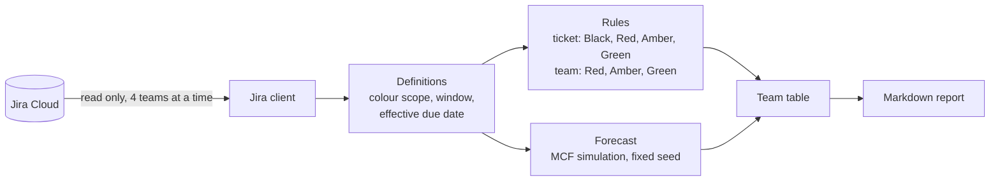

# Status Report Generator

[](https://github.com/aswinguruswamy/status-report-generator/actions/workflows/ci.yml)

A Python tool that answers "how are the teams doing?" at any time. It reads every team's
Jira project and shows one table: the colour of each team, the rule behind the colour, the
sprint progress and a forecast date. On demand it writes the same data as a Markdown report.
There is no AI in the tool: code sets every number, colour and date.

Spec: [`specs/spec.md`](specs/spec.md) (v2). The v1 weekly report with an AI summary stays in the
v1.0.0 release.

**Sample report** (made-up data): [SRG_2026-12-01_0942.md](examples/SRG_2026-12-01_0942.md)

## Known limits

- Tested on Jira Cloud **team-managed** projects only. Company-managed projects can have
  other status names and fields.
- One team = one Jira project. Programs, history and "what changed" are not in v2.
- The tool only reads Jira. It does not send the report anywhere (no e-mail, Slack or Confluence).
- "Blocked" uses the status, the flag or the label as it is now.
- The forecast needs 12 weeks (84 days) from the first closed ticket. A younger team shows
  "Not enough history yet – needs 12 weeks".
- "First closed ticket" uses the Jira Resolved date.

## The problem

A PM with several teams in Jira must answer "how are the teams doing?" at any time. Today the
PM waits for the weekly report or builds the answer by hand. Numbers are often old, and
colours are often too kind: a team without due dates looks Green.

This tool reads Jira now and sets each colour with fixed rules, so the same data always gets
the same colour, and each colour comes with its reason.

## Users

- **Project managers:** open the table when the boss asks, click a team for the details,
  make the report for the end-of-day update.
- **Executives and sponsors:** read the table and the reasons in one minute.
- **Team leads:** see their blocked, overdue and at-risk tickets.

## How it works



1. The tool reads each team's project from Jira: the open tickets, the tickets that changed
   in the last 84 days, the active sprints and the next release. It never changes Jira.
2. The **colour scope** is the active sprint (or sprints). A team with no active sprint uses
   the tickets created, moved or closed in the last 14 days.
3. Rules give each open ticket a colour, then give the team a colour and a reason.
4. The forecast gives the 85% date to finish all open tickets, from the MCF simulation code.
5. The tool writes the table as a Markdown report: `SRG_<date>_<hhmm>.md`.

## Status rules (short form)

Won't Do and Duplicate tickets are left out of every count. The **effective due date** is the
due date; if none, the end of the ticket's sprint.

**Ticket colour** (the first true rule sets it):

| Colour | Rule |
|---|---|
| ⚫ Black | Overdue: the effective due date has passed and the ticket is open. |
| 🔴 Red | Blocked. |
| 🟠 Amber | Due today or in the next 2 days and not started (To Do), or no effective due date and high priority (P1, P2). |
| 🟢 Green | All other open tickets. |

**Team colour:**

| Colour | Rule |
|---|---|
| 🔴 Red | One or more P1 or P2 tickets are Black or Red. |
| 🟠 Amber | A P3 to P5 or unmapped ticket is Black or Red, a P1 or P2 ticket is Amber, or the team closed fewer tickets than it opened in the last 14 days. |
| 🟢 Green | None of the above. A team is never Black. |

The forecast never changes a colour.

## Setup

1. Install Python 3.11 or newer. The built-in Python on a Mac is too old.
2. Make a virtual environment: `python3.12 -m venv .venv`, then `source .venv/bin/activate`.
3. Run `pip install -r requirements.txt`, then `pip install -e .`.
4. Copy `.env.example` to `.env` and add your values: the Jira site, your email, a Jira API
   token.
5. Change `config.yaml`: add your teams (Jira project key and team name).

**Caution:** Never commit the `.env` file. It contains your secrets. Git ignores it, and the
CI scans each change for secrets.

## How to run

```
status-report                          # read every team in config.yaml, write the report
status-report --demo                   # the same with the sample data: no Jira, no token
status-report --help                   # all options
```

| Option | Use |
|---|---|
| `--config` | Path to the settings file. Default: `config.yaml`. |
| `--output` | Folder for the report. Default: `output_folder` in the settings. |
| `--demo` | Use the made-up sample data in `demo/`. |

The report goes into the `output` folder. Git ignores this folder. The file name has the date
and time of the Jira read, for example `output/SRG_2026-12-01_0942.md`. The report has the
"as of" time, the team table, the reason for each team, and each team's Black, Red and Amber
tickets. Each colour is a mark and a word.

## Config options

`config.yaml` is the settings file and the source of the rules. Change the rules there, not
in the code. Only `teams` is required; each other setting has its v1 default.

| Setting | Default | Use |
|---|---|---|
| `teams` | (none) | One item for each team: `key` (Jira project key) and `name` (team name). |
| `timezone` | This computer's time zone | "Today", the 14-day window and the "as of" time use this time zone. |
| `work_types` | Story, Task, Bug | Work types to count. Epics and sub-tasks are not counted. |
| `priority_map` | Highest = P1 to Lowest = P5 | Jira priority names for P1 to P5. A list is allowed. P1 and P2 are high priority. |
| `blocked_method` | `[status]` | How to find a blocked ticket: `status`, `flag`, `label`, or more than one. |
| `blocked_status_name` | `Blocked` | The status for the `status` method. |
| `blocked_label` | `blocked` | The label for the `label` method. |
| `amber_window_days` | `2` | Amber: due within this many days and not started (status category To Do). |
| `forecast` | `true` | Show the 85% forecast date for each team. |
| `output_folder` | `output` | Folder for the reports. |

The tool stops at start, and says what to correct, when the settings file is missing or has
no teams, lists a project two times, or names a project that Jira does not know.

## Tests

```
pytest                                  # all tests, no Jira calls (a few seconds)
python scripts/make_demo.py             # make the sample Jira data again (demo/jira.json)
python scripts/make_sample.py           # make the sample report again after a layout change
```

- **Unit tests** check each rule and each acceptance criterion of the spec with a known result.
- **Demo test:** the sample data goes through the real Jira client, rules and report, offline.
- **Golden file:** the sample report in `examples/` must match the report made from the demo.
- **CI** (GitHub Actions) runs the secret scan, the style check, the dependency and licence
  scans, and all tests on Python 3.11, 3.12, and 3.13 for each pull request.

## Project documents

The [docs/](docs/) folder has PDF copies of the project's Confluence pages at v1.0.0: charter,
Decision Log, RAID Log, status rules, AI guardrails (v1 only), Definition of Done, and the sprint reviews.

## License

MIT
