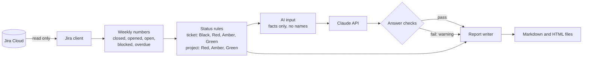

# Status Report Generator

[](https://github.com/aswinguruswamy/status-report-generator/actions/workflows/ci.yml)

A Python tool that reads one Jira project and writes a weekly status report. Fixed rules set
the RAG status. The Claude API writes a short executive summary, and the tool checks it.

**Sample report** (made-up data): [Markdown](examples/DEMO-2026-W43.md) ·
[HTML](examples/DEMO-2026-W43.html)

## The problem

Each week, a project manager reads Jira, counts the work, decides on a status colour, and
writes the summary. This takes time. Two managers can give the same week different colours.
An AI tool alone can write a good text, but it can also make up a status or a fact.

This tool makes the report in less than 2 minutes. Rules set the status, so the same week
always gets the same colour. The AI only explains the facts, and the tool removes an AI text
that breaks a rule.

## Users

- **Project managers and Scrum Masters:** run the tool each week and send the report.
- **Executives and sponsors:** read the status, the summary, and the risks in one minute.
- **Team leads:** see the blocked and overdue work, with the owner and the days.

## How it works



1. The tool reads the tickets of the week from Jira, with the status history. It never
   changes Jira.
2. It counts the numbers at the end of the week, from the status history.
3. Rules from `config.yaml` give each open ticket a status, then give the project a status.
4. The AI gets only the facts: numbers, statuses, ticket keys, priorities, and titles (titles
   can be hidden). It never gets names, email addresses, descriptions, or comments.
5. The tool checks the AI answer. If the answer breaks a rule, the tool removes it and adds a
   warning. If the AI is not available, the tool still makes the full report.
6. The tool writes the report as Markdown and HTML.

## Status rules (short form)

**Ticket status** (the first true rule sets it):

| Status | Rule |
|---|---|
| ⚫ Black | Overdue: the due date has passed and the ticket is open. |
| 🔴 Red | Blocked, not overdue. |
| 🟠 Amber | Due today or in the next 2 days, and not started (still in the To Do category). |
| 🟢 Green | All other open tickets. |

**Project status:**

| Status | Rule |
|---|---|
| 🔴 Red | One or more P1 or P2 tickets are Red or Black. |
| 🟠 Amber | A P3 to P5 or unmapped ticket is Red or Black, a P1 or P2 ticket is Amber, or the team closed fewer tickets than it opened. |
| 🟢 Green | None of the above. |

The full rules, with examples and special cases: [docs/RAG-Rules.pdf](docs/RAG-Rules.pdf).

## Setup

1. Install Python 3.11 or newer. The built-in Python on a Mac is too old.
2. Make a virtual environment: `python3.12 -m venv .venv`, then `source .venv/bin/activate`.
3. Run `pip install -r requirements.txt`, then `pip install -e .`.
4. Copy `.env.example` to `.env` and add your values: the Jira site, your email, a Jira API
   token, and a Claude API key.
5. Change `config.yaml` for your Jira project.

**Caution:** Never commit the `.env` file. It contains your secrets. Git ignores it, and the
CI scans each change for secrets.

## How to run

```
status-report                          # last full week, settings from config.yaml
status-report --week 2026-10-19        # the week that contains this day
status-report --project SRG --format both --no-ai
status-report --help                   # all options
```

| Option | Use |
|---|---|
| `--project` | Jira project key. Default: `config.yaml`. |
| `--week` | A day in the week to report (YYYY-MM-DD). Default: the last full week. |
| `--format` | `md`, `html`, or `both`. Default: `config.yaml`. |
| `--output` | Folder for the report. Default: `config.yaml`. |
| `--no-ai` | Make the report without the AI summary. No API call. |
| `--config` | Path to `config.yaml`. |

The report goes into the `output` folder. Git ignores this folder. The file name has the
project key and the ISO week, for example `output/SRG-2026-W43.md`. For the current week,
the numbers are the state now, not at the end of the week.

Both files have the same sections and data, in this order: project status, executive
summary, key numbers, priority matrix, blocked tickets, overdue tickets, closed this week,
next week, warnings, and all tickets. Each status is a colour mark and a word. The HTML
report is one file with no external links. It is easy to read on a phone and prints
clearly in black and white.

## Config options

`config.yaml` is the source of the rules. Change the rules there, not in the code.

| Setting | Default | Use |
|---|---|---|
| `jira.project_key` | `SRG` | Jira project to read. |
| `jira.timezone` | `America/Toronto` | The week is Monday to Sunday in this time zone. |
| `work_types` | Story, Task, Bug | Work types to count. Epics and subtasks are not counted. |
| `priority_map` | Highest = P1 to Lowest = P5 | Jira priority names for P1 to P5. A list is allowed. |
| `blocked_method` | `[status]` | How to find a blocked ticket: `status`, `flag`, `label`, or more than one. |
| `blocked_status_name` | `Blocked` | The status for the `status` method. |
| `blocked_label` | `blocked` | The label for the `label` method. |
| `ticket_status.amber_window_days` | `2` | Amber: due within this many days... |
| `ticket_status.amber_status_category` | `To Do` | ...and still in this status category. |
| `project_status.high_priorities` | `[P1, P2]` | Priorities that make the project Red. |
| `ai.enabled` | `true` | Make the AI summary. |
| `ai.model` | `claude-sonnet-5-5` | The Claude model. |
| `ai.max_tokens_per_run` | `8000` | Cost limit for each run, input and output tokens. |
| `ai.hide_titles_from_ai` | `false` | `true`: the AI never gets ticket titles. |
| `output.folder` | `output` | Folder for the reports. |
| `output.formats` | `[markdown, html]` | The formats to write. |

## Cost of the AI summary

The AI evaluation set used 770 to 1,090 tokens for each run (most of them are input).
With the Claude Sonnet 5.5 prices in October 2026 ($2 for each million input tokens, $10 for
each million output tokens), one run costs less than US$0.01. The tool never sends more than
the `max_tokens_per_run` limit (8,000 tokens). At that limit, one run costs less than
US$0.03. Prices change: see [Claude pricing](https://platform.claude.com/docs/en/about-claude/pricing).

## Tests

```
pytest                                  # all tests, no API calls (about 5 seconds)
python -m status_report.evaluation      # AI evaluation set: 5 real Claude API calls
python scripts/make_sample.py           # make the sample report again after a layout change
```

- **Unit and scenario tests** check each status rule with a known result.
- **Random tests** make 300 difficult weeks with a fixed seed and check that the tool survives:
  special characters, empty weeks, more than 100 tickets. A failing week is saved in
  `tests/regressions/` as a permanent test.
- **Format tests** check that the Markdown and HTML reports have the same sections and data.
- **AI guardrail tests** try to trick each answer check: a key that is not in the input, a
  changed or negated status, soft words in a Red week.
- **AI evaluation set** (`eval/samples/`) checks the quality of the real AI summary: a red, an
  amber, a green, an empty week, a week with hidden titles, and a week with quotes and braces in
  the titles. Run it after each change to the
  prompt or the model. It shows the AI text for each failed sample.
- **CI** (GitHub Actions) runs the secret scan, the style check, and all tests on Python 3.11,
  3.12, and 3.13 for each pull request.

## Known limits

- Tested on Jira Cloud **team-managed** projects only. Company-managed projects can have
  other status names and fields.
- One Jira project for each run.
- The report reads Jira. It does not write to Confluence or Slack (planned for v2).
- The flag and the label methods for "blocked" use today's value, because Jira does not keep
  their history. The status method uses the history.

## Project documents

The [docs/](docs/) folder has PDF copies of the project's Confluence pages at v1.0.0: charter,
Decision Log, RAID Log, status rules, AI guardrails, Definition of Done, and the sprint reviews.

## License

MIT
